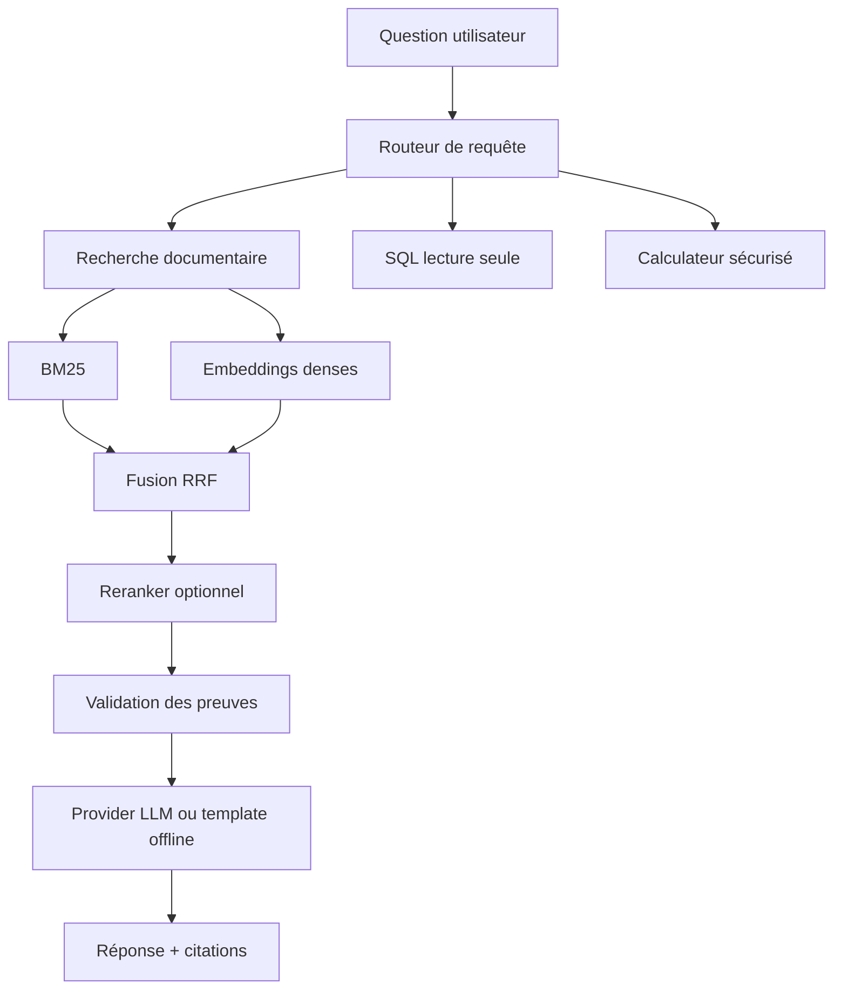

# Enterprise RAG & Agentic AI Platform

Plateforme de connaissance d’entreprise conçue comme un projet de portfolio Data Science / NLP / Generative AI. Elle répond à des questions sur des politiques RH, finance, sécurité et conformité en combinant documents non structurés, recherche lexicale, recherche dense, outils SQL et calcul déterministe.

Le projet privilégie une exécution locale sur une machine CPU avec 8 Go de RAM. Le chemin par défaut ne nécessite ni clé API, ni GPU, ni Qdrant distant : il utilise un embedder hashing déterministe, BM25 et un provider de réponse offline. L’interface principale est une web app responsive servie par FastAPI. Les backends SentenceTransformers, CrossEncoder, Qdrant, LangGraph, MLflow, OpenAI-compatible et Ollama sont disponibles en options.

## Fonctionnalités

- ingestion PDF, TXT, Markdown, DOCX et HTML avec métadonnées et pages PDF ;
- nettoyage conservateur et chunking fixed/section-aware ;
- baseline BM25, embeddings CPU, fusion hybride RRF et reranking optionnel ;
- citations `[S1]`, validation des preuves et refus si le corpus est insuffisant ;
- agent contrôlé avec routage document/SQL/métadonnées/calculateur ;
- SQLite en lecture seule pour les données structurées synthétiques ;
- FastAPI, Streamlit, Docker Compose, tests pytest, Ruff et CI GitHub Actions ;
- interface web responsive avec chat, explorer documentaire, dashboard qualité et statut système ;
- ajout de documents PDF, TXT, Markdown, DOCX et HTML depuis l’interface, avec réindexation automatique ;
- bouton `Attach` directement dans le chat pour envoyer ces documents ainsi que des images PNG, JPG ou WebP ; les images sont stockées comme pièces jointes visuelles dans le profil local actuel ;
- questions vocales côté navigateur via Web Speech API (Chrome/Edge), sans envoyer l’audio au serveur ;
- corpus synthétique extensible à plus de 500 documents grâce à `--generated-count` ;
- benchmark reproductible, analyse d’erreurs et intégration MLflow optionnelle ;
- profil Docker de staging avec Qdrant persistant, Redis/worker, MinIO, PostgreSQL, API key, readiness checks et audit des uploads.

## Architecture



## Résultats mesurés

Les nombres ci-dessous proviennent de l’exécution locale du benchmark du 19 août 2026 sur 52 questions answerable, 636 documents et 1 908 chunks. Les 8 questions non answerable sont conservées pour l’évaluation des refus RAG. Les résultats sont régénérables avec `scripts/run_benchmark.py`.

| Pipeline | Recall@5 | MRR | nDCG@5 | Latence moyenne (ms) |
|---|---:|---:|---:|---:|
| BM25 | 0.933 | 0.917 | 0.903 | 8.406 |
| Dense hashing | 0.507 | 0.451 | 0.424 | 0.470 |
| Hybrid RRF | 0.731 | 0.679 | 0.653 | 11.139 |
| Hybrid + reranker lexical fallback | 0.782 | 0.798 | 0.771 | 10.563 |

Le reranker CrossEncoder est implémenté mais n’a pas été téléchargé ni évalué dans cette exécution afin de préserver la contrainte mémoire. Le résultat de reranking ci-dessus est explicitement celui du fallback lexical.

L’évaluation offline RAG sur les mêmes 60 questions a produit un taux de signal attendu de `0.717`, une couverture soutenue par le contexte de `0.917` et un taux de refus de `0.133` (les 8 questions explicitement non answerable sont refusées). L’évaluation agentique sur 5 routes étiquetées a produit une précision de routage de `1.000`, 1.2 appels outil en moyenne et 0 retry.

## Installation Windows

Si Python n’est pas présent dans le PATH, utilisez la runtime Python fournie par Codex :

```powershell
$py = "C:\Users\Probook\.cache\codex-runtimes\codex-primary-runtime\dependencies\python\python.exe"
& $py -m venv .venv
& .\.venv\Scripts\python.exe -m pip install -e ".[dev]"
```

Pour les backends optionnels :

```powershell
& .\.venv\Scripts\python.exe -m pip install -e ".[qdrant,retrieval,agent,tracking,documents]"
```

Copiez `.env.example` vers `.env` et renseignez uniquement les variables nécessaires. `.env` est ignoré par Git.

## Exécution locale

```powershell
& .\.venv\Scripts\python.exe scripts/create_demo_data.py --generated-count 600
& .\.venv\Scripts\python.exe scripts/ingest.py
& .\.venv\Scripts\python.exe scripts/build_index.py
& .\.venv\Scripts\python.exe scripts/create_company_db.py
& .\.venv\Scripts\python.exe scripts/evaluate_retrieval.py
& .\.venv\Scripts\python.exe scripts/evaluate_rag.py
& .\.venv\Scripts\python.exe scripts/evaluate_agent.py
& .\.venv\Scripts\python.exe scripts/run_benchmark.py
```

API :

```powershell
& .\.venv\Scripts\python.exe -m uvicorn enterprise_rag.api.main:app --reload
```

Puis ouvrez l’interface web professionnelle sur `http://localhost:8000/` ou la documentation API sur `http://localhost:8000/docs`.

Depuis l’onglet `Document Explorer`, le bouton `Add documents` accepte plusieurs fichiers à la fois. Le bouton `Attach` est également disponible dans le chat. Chaque fichier est validé (format et taille maximale de 25 MB) ; les documents sont enregistrés dans `data/raw/uploads/documents`, ingérés et ajoutés à l’index sans redémarrer l’API. Les images sont conservées dans `data/raw/uploads/images` et affichées comme pièces jointes visuelles ; l’OCR/vision multimodale pourra être activé avec un provider dédié. La commande `create_demo_data.py` génère 600 documents synthétiques supplémentaires par défaut ; utilisez `--generated-count 0` pour revenir au corpus de démonstration de base.

Dans le chat, `Voice` transcrit la question dans le navigateur. Chrome et Edge sont recommandés ; le navigateur demandera l’autorisation d’utiliser le microphone. La transcription reste éditable avant l’envoi au RAG.

Le fichier Streamlit historique reste disponible en option avec `pip install -e ".[frontend]"`, mais il n’est plus nécessaire pour l’utilisation normale.

## Docker

```powershell
docker compose up --build
```

Pour arrêter les services : `docker compose down`.

Le profil Docker production-like démarre Qdrant, Redis, le worker, MinIO et PostgreSQL. La procédure complète est disponible dans [docs/DEPLOYMENT_GUIDE.md](<C:\Users\Probook\Documents\ChatGPT\Enterprise RAG & Agentic AI Platform\docs\DEPLOYMENT_GUIDE.md>). Pour activer MLflow :

```powershell
docker compose --profile tracking up --build
```

## Tests et qualité

```powershell
& .\.venv\Scripts\python.exe -m pytest
& .\.venv\Scripts\ruff.exe check src scripts tests
```

Les tests standards ne font aucun appel LLM payant. Les intégrations externes sont optionnelles.

## Structure

```text
configs/                  Configuration YAML
data/raw/                 Corpus synthétique par département
data/evaluation/          Questions de retrieval et de routage
src/enterprise_rag/       Ingestion, retrieval, RAG, agent, API et monitoring
scripts/                  Commandes reproductibles
frontend_web/             Interface web principale responsive
frontend/                 Interface Streamlit historique optionnelle
results/                  CSV/JSON/rapports générés
docs/                     Rapport scientifique, CV et guide d’entretien
tests/                    Tests unitaires et API
```

## Limites et améliorations futures

Le corpus de démonstration est fictif et les 600 documents additionnels sont générés pour tester la volumétrie, pas pour représenter une entreprise réelle. Le provider template ne remplace pas l’évaluation d’un LLM réel, la qualité du hashing ne représente pas celle d’un modèle d’embeddings multilingue, et le CrossEncoder n’a pas été exécuté dans le benchmark par défaut.
