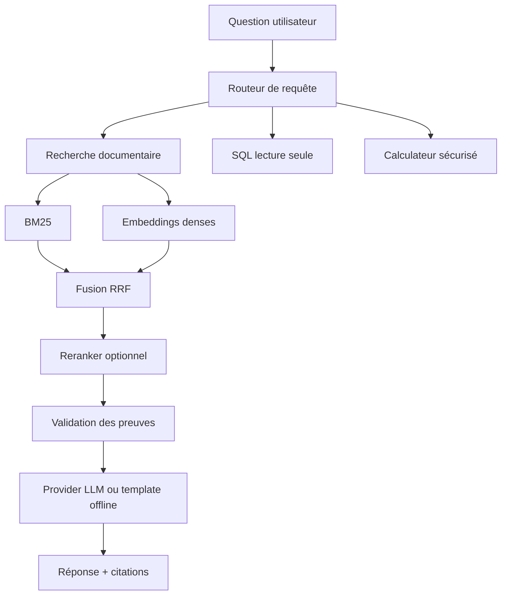
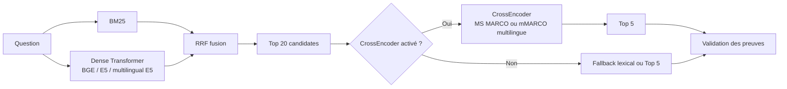
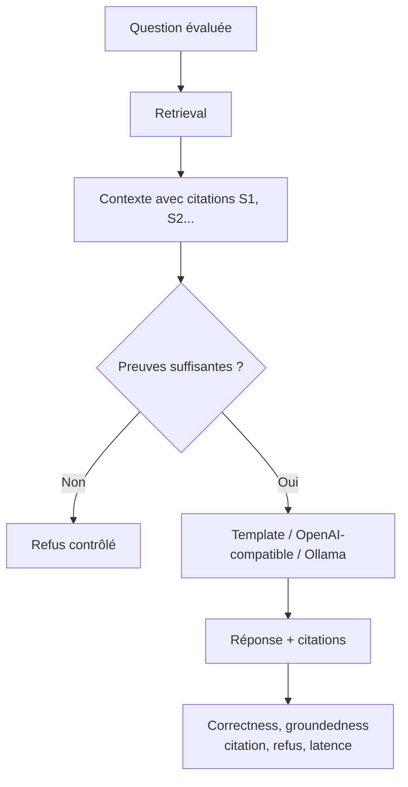
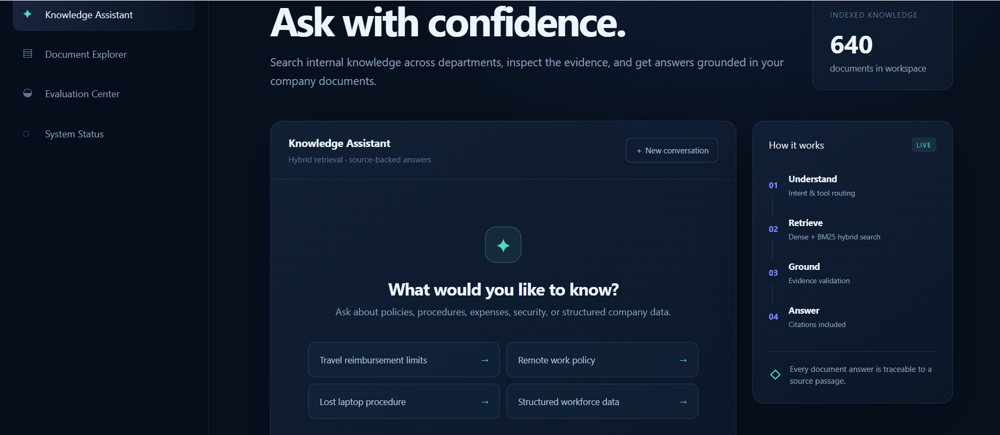
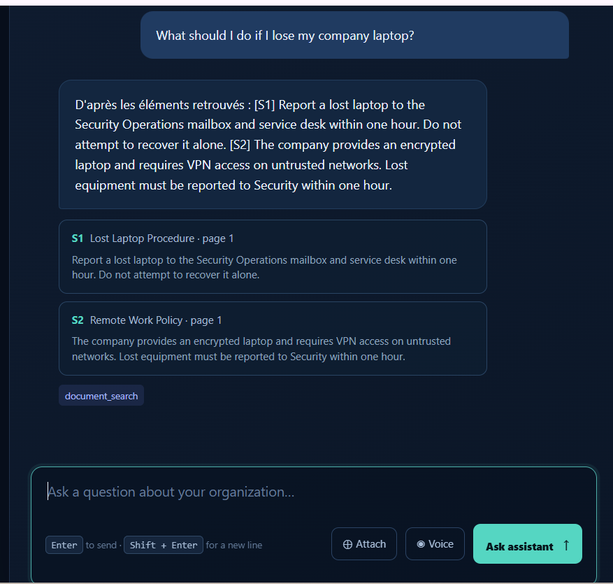

# Enterprise RAG & Agentic AI Platform

Plateforme de connaissance d’entreprise conçue comme un projet de portfolio Data Science / NLP / Generative AI. Elle répond à des questions sur des politiques RH, finance, sécurité et conformité en combinant documents non structurés, recherche lexicale, recherche dense, outils SQL et calcul déterministe.

Le backend dense principal est configurable et cible `BAAI/bge-small-en-v1.5`, avec `intfloat/e5-small-v2` et `intfloat/multilingual-e5-small` (français/arabe/anglais et autres langues) en alternatives ; le hashing reste le baseline offline et le fallback sans téléchargement. BM25, Qdrant, CrossEncoder, LangGraph, MLflow, OpenAI-compatible et Ollama sont disponibles en options.

## Fonctionnalités

- ingestion PDF, TXT, Markdown, DOCX et HTML avec métadonnées et pages PDF ;
- nettoyage conservateur et chunking fixed/section-aware ;
- baseline BM25/hashing, embeddings Transformer CPU normalisés, fusion hybride RRF, embedding multilingue E5 (`intfloat/multilingual-e5-small`) et CrossEncoder optionnel (`cross-encoder/ms-marco-MiniLM-L-6-v2` ou `cross-encoder/mmarco-mMiniLMv2-L12-H384-v1`) ;
- citations `[S1]`, validation des preuves et refus si le corpus est insuffisant ;
- agent contrôlé avec routage document/SQL/métadonnées/calculateur ;
- SQLite en lecture seule pour les données structurées synthétiques ;
- FastAPI, Streamlit, Docker Compose, tests pytest, Ruff et CI GitHub Actions ;
- interface web responsive avec chat, explorer documentaire, dashboard qualité et statut système ;
- ajout de documents PDF, TXT, Markdown, DOCX et HTML depuis l’interface, avec réindexation automatique ;
- bouton `Attach` directement dans le chat pour envoyer ces documents ainsi que des images PNG, JPG ou WebP ; les images sont stockées comme pièces jointes visuelles dans le profil local actuel ;
- questions vocales côté navigateur via Web Speech API (Chrome/Edge), sans envoyer l’audio au serveur ;
- corpus synthétique extensible à plus de 500 documents grâce à `--generated-count` ;
- benchmark reproductible, analyse d’erreurs et intégration MLflow optionnelle ;
- profil Docker de staging avec Qdrant persistant, Redis/worker, MinIO, PostgreSQL, API key, readiness checks et audit des uploads.

## Architecture



### Pipeline retrieval



### Pipeline RAG et évaluation



## Captures d’écran







## Résultats mesurés

Les nombres ci-dessous proviennent de l’exécution locale du benchmark du 20 août 2026 sur 62 questions answerable, 640 documents et 1 936 chunks. Les 8 questions `unanswerable` sont conservées pour l’évaluation RAG. Les résultats sont régénérables avec `scripts/run_benchmark.py` ; les chiffres machine-readable sont dans `results/retrieval/`.

| Pipeline | Recall@1 | Recall@3 | Recall@5 | Recall@10 | MRR | nDCG@5 | HitRate@5 | Latence ms |
|---|---:|---:|---:|---:|---:|---:|---:|---:|
| BM25 | 0.714 | 0.866 | 0.895 | 0.926 | 0.881 | 0.864 | 0.952 | 6.632 |
| Dense hashing | 0.198 | 0.412 | 0.474 | 0.518 | 0.387 | 0.374 | 0.548 | 0.328 |
| Hybrid RRF (hashing) | 0.410 | 0.632 | 0.782 | 0.854 | 0.642 | 0.646 | 0.839 | 7.545 |
| Hybrid + lexical fallback | 0.427 | 0.668 | 0.699 | 0.699 | 0.610 | 0.619 | 0.758 | 7.982 |

| Catégorie | Pipeline | Questions | Recall@5 | MRR | nDCG@5 | HitRate@5 |
|---|---|---:|---:|---:|---:|---:|
| `lexical_exact` | BM25 | 36 | 1.000 | 0.968 | 0.976 | 1.000 |
| `semantic_paraphrase` | BM25 | 12 | 0.750 | 0.705 | 0.696 | 0.750 |
| `semantic_paraphrase` | Dense hashing | 12 | 0.417 | 0.197 | 0.251 | 0.417 |
| `semantic_paraphrase` | Hybrid RRF (hashing) | 12 | 0.625 | 0.479 | 0.496 | 0.667 |
| `multi_document` | BM25 | 8 | 0.938 | 0.813 | 0.826 | 1.000 |
| `multi_document` | Hybrid RRF (hashing) | 8 | 0.875 | 0.671 | 0.711 | 1.000 |


### Benchmark réel BGE

Résultats mesurés sur 62 questions answerable, 640 documents et 1 936 chunks, sur CPU. Le modèle utilisé est `BAAI/bge-small-en-v1.5`.

```powershell
$env:EMBEDDING_LOCAL_FILES_ONLY="false"
$env:BENCHMARK_MULTILINGUAL="false"
& .\.venv\Scripts\python.exe scripts\run_benchmark.py
```

Les résultats sont écrits dans `results/retrieval/final_benchmark.csv` et `results/retrieval/final_benchmark.json`.

| Pipeline réel | Modèle | Recall@5 | MRR | nDCG@5 | Latence ms |
|---|---|---:|---:|---:|---:|
| Dense BGE | `BAAI/bge-small-en-v1.5` | 0.912 | 0.875 | 0.843 | 18.688 |
| BM25 + BGE RRF | `BAAI/bge-small-en-v1.5` | 0.944 | 0.928 | 0.904 | 30.272 |

### Benchmark réel CrossEncoder

Résultats mesurés sur le même corpus. Le CrossEncoder rerank les 20 candidats hybrides et conserve les 5 meilleurs. Le benchmark anglais utilise `cross-encoder/ms-marco-MiniLM-L-6-v2` ; le benchmark multilingue utilise `cross-encoder/mmarco-mMiniLMv2-L12-H384-v1`.

```powershell
$env:EMBEDDING_LOCAL_FILES_ONLY="false"
$env:RERANKER_ENABLED="true"
$env:RERANKER_MODEL="cross-encoder/ms-marco-MiniLM-L-6-v2"
$env:MULTILINGUAL_RERANKER_MODEL="cross-encoder/mmarco-mMiniLMv2-L12-H384-v1"
$env:BENCHMARK_MULTILINGUAL="true"
& .\.venv\Scripts\python.exe scripts\run_benchmark.py
```

| Pipeline réel | Modèle | Recall@5 | MRR | nDCG@5 | Latence ms |
|---|---|---:|---:|---:|---:|
| Hybrid + CrossEncoder | `cross-encoder/ms-marco-MiniLM-L-6-v2` | 0.929 | 0.901 | 0.883 | 316.756 |
| Hybrid + Multilingual CrossEncoder | `cross-encoder/mmarco-mMiniLMv2-L12-H384-v1` | 0.929 | 0.976 | 0.933 | 655.925 |

### Évaluation avec vrai LLM

Les scores RAG présentés plus haut utilisent le provider template offline. Pour évaluer une vraie génération, configure un provider OpenAI-compatible ou Ollama, puis relance `evaluate_rag.py`. Les clés API ne doivent jamais être ajoutées au dépôt.

Exemple OpenAI-compatible :

```powershell
$env:LLM_PROVIDER="openai"
$env:LLM_MODEL="nom-du-modele"
$env:OPENAI_API_KEY="votre-cle-api"
& .\.venv\Scripts\python.exe scripts\evaluate_rag.py
```

| Provider | Configuration | Artefacts produits |
|---|---|---|
| OpenAI-compatible | `LLM_PROVIDER=openai`, `LLM_MODEL` et `OPENAI_API_KEY` | `results/rag/rag_summary.json` et `results/rag/rag_question_results.csv` |
| Ollama | `LLM_PROVIDER=ollama`, `LLM_MODEL` et `OLLAMA_BASE_URL` | `results/rag/rag_summary.json` et `results/rag/rag_question_results.csv` |

Les mesures générées sont disponibles dans `results/rag/rag_summary.json` et `results/rag/rag_question_results.csv`. Une évaluation humaine reste recommandée pour confirmer la factualité et la qualité des réponses.

### Évaluation RAG mesurée

Les 70 questions utilisent le même provider template offline. `answer_correctness` est un proxy déterministe basé sur le signal attendu du dataset ; ce n’est pas une annotation humaine.

| Pipeline | Correctness | Groundedness | Citation accuracy | Citation recall | Correct refusal | False refusal | Unsupported answer | Latence ms |
|---|---:|---:|---:|---:|---:|---:|---:|---:|
| BM25 RAG | 0.786 | 0.900 | 0.524 | 0.827 | 0.900 | 0.043 | 0.057 | 7.287 |
| Dense RAG | 0.514 | 0.686 | 0.382 | 0.448 | 0.686 | 0.257 | 0.057 | 0.421 |
| Hybrid RAG | 0.657 | 0.800 | 0.516 | 0.650 | 0.800 | 0.143 | 0.057 | 8.473 |
| Hybrid + lexical fallback RAG | 0.657 | 0.829 | 0.490 | 0.677 | 0.829 | 0.114 | 0.057 | 8.614 |
| Hybrid + CrossEncoder RAG | 0.786 | 0.914 | 0.444 | 0.803 | 0.914 | 0.029 | 0.057 | 376.246 |
| Dense Multilingual E5 RAG | 0.743 | 0.871 | 0.520 | 0.793 | 0.871 | 0.071 | 0.057 | 23.249 |
| Hybrid Multilingual E5 RAG | 0.757 | 0.943 | 0.532 | 0.823 | 0.943 | 0.000 | 0.057 | 55.078 |
| Hybrid + Multilingual CrossEncoder RAG | 0.800 | 0.943 | 0.502 | 0.858 | 0.943 | 0.000 | 0.057 | 1088.036 |

L’évaluation agentique sur 5 routes étiquetées reste disponible avec `scripts/evaluate_agent.py`. L’exécution avec un provider réel se fait en renseignant uniquement les variables `.env` ; les tests, le retrieval et les benchmarks n’en ont pas besoin.

## Installation Windows

Si Python n’est pas présent dans le PATH, utilisez la runtime Python fournie par Codex :

```powershell
$py = "C:\Users\Probook\.cache\codex-runtimes\codex-primary-runtime\dependencies\python\python.exe"
& $py -m venv .venv
& .\.venv\Scripts\python.exe -m pip install -e ".[dev]"
```

Pour les backends optionnels :

```powershell
& .\.venv\Scripts\python.exe -m pip install -e ".[qdrant,retrieval,agent,tracking,documents]"
```

Copiez `.env.example` vers `.env` et renseignez uniquement les variables nécessaires. `.env` est ignoré par Git.

Configuration minimale recommandée :

```dotenv
EMBEDDING_MODEL=BAAI/bge-small-en-v1.5
EMBEDDING_DEVICE=cpu
RERANKER_ENABLED=false
LLM_PROVIDER=template
```

Pour utiliser directement l’embedding multilingue et le CrossEncoder mMARCO :

```dotenv
EMBEDDING_MODEL=intfloat/multilingual-e5-small
RERANKER_MODEL=cross-encoder/mmarco-mMiniLMv2-L12-H384-v1
RERANKER_ENABLED=true
```

Pour activer le reranking réel après installation des modèles :

```powershell
$env:RERANKER_ENABLED="true"
```

## Exécution locale

```powershell
& .\.venv\Scripts\python.exe scripts/create_demo_data.py --generated-count 600
& .\.venv\Scripts\python.exe scripts/ingest.py
& .\.venv\Scripts\python.exe scripts/build_index.py
& .\.venv\Scripts\python.exe scripts/create_company_db.py
& .\.venv\Scripts\python.exe scripts/evaluate_retrieval.py
& .\.venv\Scripts\python.exe scripts/evaluate_rag.py
& .\.venv\Scripts\python.exe scripts/evaluate_agent.py
& .\.venv\Scripts\python.exe scripts/run_benchmark.py
```

API :

```powershell
& .\.venv\Scripts\python.exe -m uvicorn enterprise_rag.api.main:app --reload
```

Puis ouvrez l’interface web professionnelle sur `http://localhost:8000/` ou la documentation API sur `http://localhost:8000/docs`.

Depuis l’onglet `Document Explorer`, le bouton `Add documents` accepte plusieurs fichiers à la fois. Le bouton `Attach` est également disponible dans le chat. Chaque fichier est validé (format et taille maximale de 25 MB) ; les documents sont enregistrés dans `data/raw/uploads/documents`, ingérés et ajoutés à l’index sans redémarrer l’API. Les images sont conservées dans `data/raw/uploads/images` et affichées comme pièces jointes visuelles ; l’OCR/vision multimodale pourra être activé avec un provider dédié. La commande `create_demo_data.py` génère 600 documents synthétiques supplémentaires par défaut ; utilisez `--generated-count 0` pour revenir au corpus de démonstration de base.

Dans le chat, `Voice` transcrit la question dans le navigateur. Chrome et Edge sont recommandés ; le navigateur demandera l’autorisation d’utiliser le microphone. La transcription reste éditable avant l’envoi au RAG.


## Docker

```powershell
docker compose up --build
```

Pour arrêter les services : `docker compose down`.

Le profil Docker production-like démarre Qdrant, Redis, le worker, MinIO et PostgreSQL. La procédure complète est disponible dans [docs/DEPLOYMENT_GUIDE.md](docs/DEPLOYMENT_GUIDE.md). Pour activer MLflow :

```powershell
docker compose --profile tracking up --build
```

## Tests et qualité

```powershell
& .\.venv\Scripts\python.exe -m pytest
& .\.venv\Scripts\ruff.exe check src scripts tests
```

Les tests standards ne font aucun appel LLM payant. Les intégrations externes sont optionnelles.

## Structure

```text
configs/                  Configuration YAML
data/raw/                 Corpus synthétique par département
data/evaluation/          Questions de retrieval et de routage
src/enterprise_rag/       Ingestion, retrieval, RAG, agent, API et monitoring
scripts/                  Commandes reproductibles
frontend_web/             Interface web principale responsive
frontend/                 Interface Streamlit historique optionnelle
results/                  CSV/JSON/rapports générés
docs/                     Rapport scientifique, CV et guide d’entretien
tests/                    Tests unitaires et API
```

## Limites et améliorations futures

Le corpus de démonstration est fictif et les 600 documents additionnels servent à tester la volumétrie. Les résultats BGE, E5 et CrossEncoder sont mesurés sur ce corpus ; les scores RAG du tableau principal utilisent le provider template offline et constituent des proxies déterministes, pas une évaluation humaine d’un LLM réel. Les catégories metadata restent difficiles pour les retrievers documentaires car elles devraient idéalement passer par un filtre structuré.


## Auteur

Bouizdouzene Bilal
